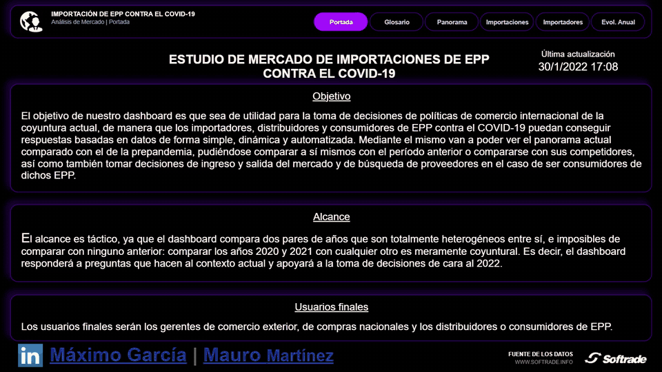
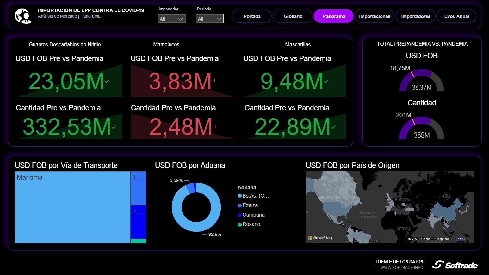
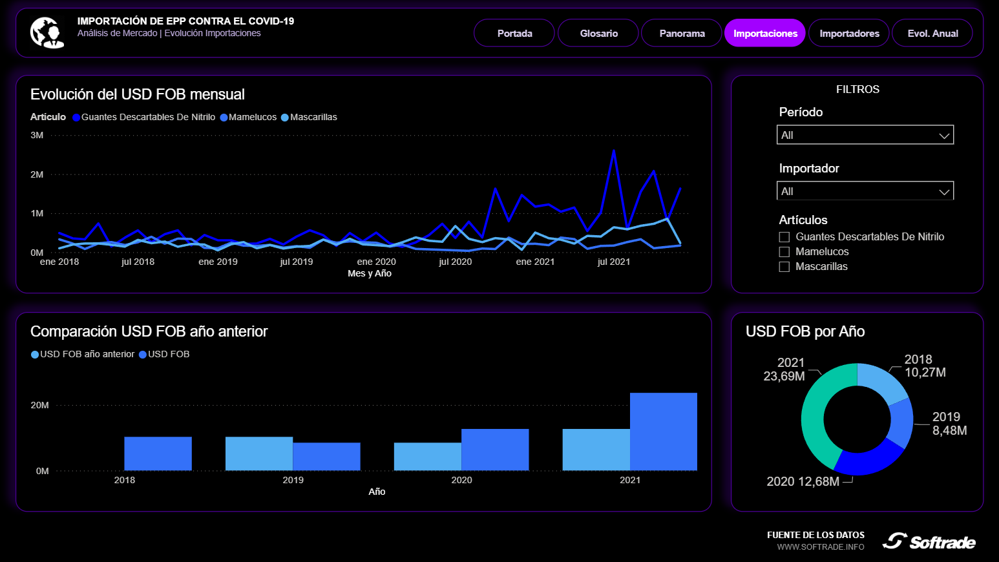
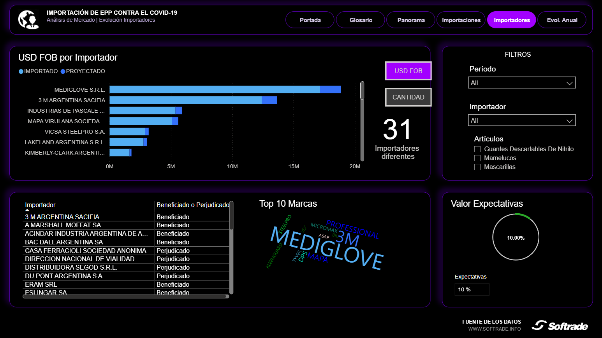
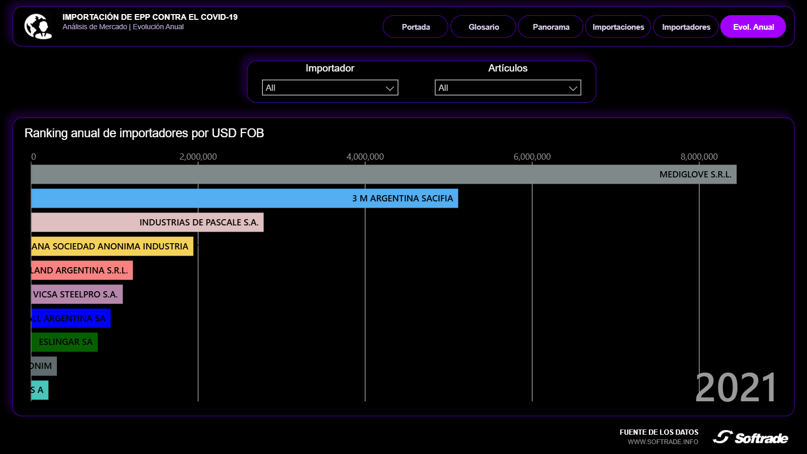
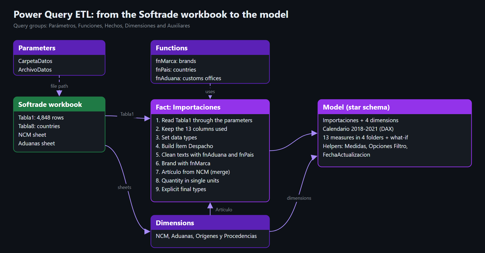
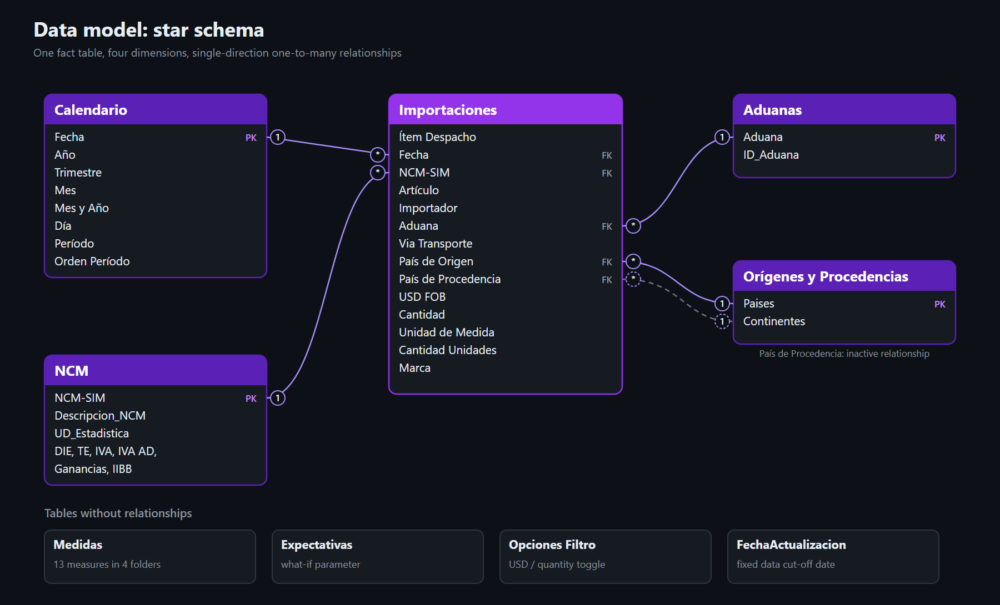
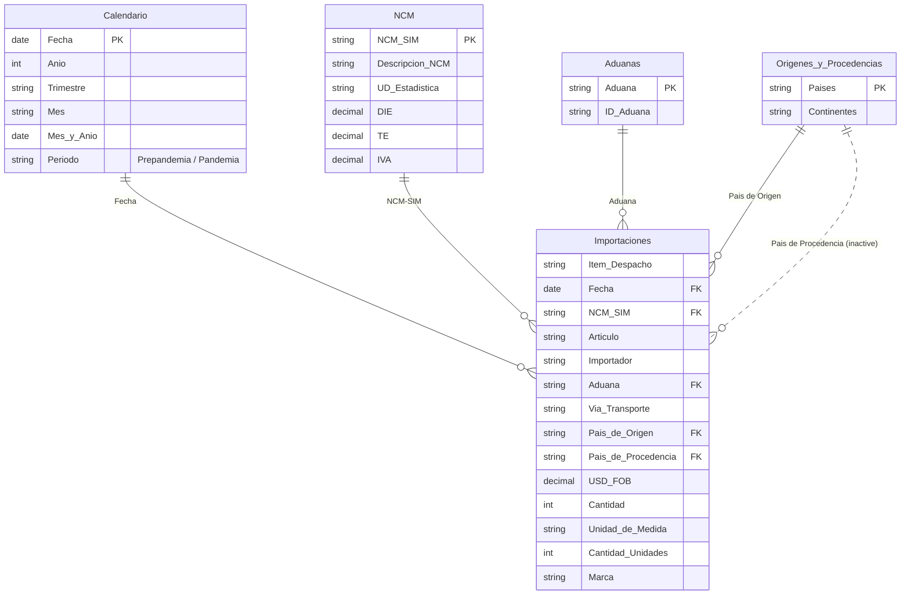

# 🛡️ Estudio de mercado de importaciones de EPP COVID-19 (prepandemia vs. pandemia)
<p>
  <a href="README.md"></a>
  <a href="README.es.md"></a>
</p>

## 📽️ Vista previa del dashboard
<p align="center">
  
</p>

<p align="center"><a href="docs/Preview-v2.mp4">▶️ Ver el recorrido en calidad completa (MP4)</a></p>

> Proyecto final del curso de Data Analyst de CoderHouse, hecho junto con Máximo García. El dashboard está en español.
> El repositorio incluye el reporte como **Power BI Project (PBIP)**, así que el modelo de datos, las medidas DAX y el código de Power Query se pueden leer directamente acá en GitHub. Los datos no se publican (ver [Sobre los datos](#-sobre-los-datos)).

**Stack:**     

## 📋 Resumen ejecutivo
Un estudio de mercado de las importaciones argentinas de Equipos de Protección Personal (EPP) para tres productos: **guantes descartables de nitrilo, barbijos y mamelucos de protección**. Compara el período prepandemia (**2018-2019**) con el período COVID-19 (**2020-2021**), de 24 meses cada uno.

Los datos provienen de registros aduaneros de importación de **Softrade**: 4.848 filas, compuestas por 3.696 ítems de despacho valorizados más 1.152 líneas de marca y descripción que no tienen valor ni cantidad. El reporte es **estático por diseño**: los dos períodos son fijos y la fecha de corte de los datos es el 30 de enero de 2022.

Responde preguntas como: cuánto creció cada producto, qué países e importadores impulsaron ese crecimiento, cómo cambiaron los precios y las vías de transporte, y cómo se compara un importador con sus competidores.

## 📈 Hallazgos principales

| Indicador (USD FOB) | 2018-2019 | 2020-2021 | Variación |
|---|---:|---:|---:|
| **Total de importaciones de EPP** | 18,75 M | 36,37 M | **+94%** |
| Guantes descartables de nitrilo | 8,77 M | 23,05 M | +163% |
| Barbijos | 4,67 M | 9,48 M | +103% |
| Mamelucos de protección | 5,30 M | 3,83 M | **-28%** |
| Flete aéreo | 0,09 M (0,5% del valor) | 2,98 M (8,2% del valor) | x32 |

- **Los guantes lideraron todos los años** y explicaron la mayor parte del crecimiento: 15,37 M solo en 2021, el 65% de las importaciones de ese año.
- **Los mamelucos fueron la excepción:** durante la pandemia cayeron tanto el valor (-28%) como las unidades (-38%).
- **Malasia aportó el 47% del valor**, seguida por China (23%) y Estados Unidos (14%). Las importaciones desde Malasia pasaron de 7,04 M a 18,73 M.
- **Los precios se movieron en direcciones opuestas:** el barbijo promedio bajó de USD 0,89 a USD 0,41 por unidad (-53%), mientras que el guante de nitrilo promedio subió de USD 0,046 a USD 0,069 (+52%).
- **23 de los 31 importadores compraron más** durante la pandemia, 8 de ellos sin compras en 2018-2019. MEDIGLOVE S.R.L. más que triplicó sus compras (de 4,02 M a 13,14 M) y lidera el mercado.
- **La aduana de Buenos Aires (Capital)** despachó el 93% del valor.

Son cambios observados entre dos períodos fijos. Los datos muestran qué cambió, no por qué cambió.

## 🖥️ Páginas del dashboard

<table>
  <tr>
    <td width="50%"><br><b>Panorama</b>: tarjetas de KPI y medidores para ambos períodos, vía de transporte, aduana y país de origen.</td>
    <td width="50%"><br><b>Evolución Importaciones</b>: valor FOB mensual por producto, comparación interanual y participación por año.</td>
  </tr>
  <tr>
    <td width="50%"><br><b>Evolución Importadores</b>: ranking de importadores con una proyección what-if (en USD o en unidades), importadores que ganaron o perdieron, y principales marcas.</td>
    <td width="50%"><br><b>Evolución Anual</b>: carrera de barras animada (bar chart race) de los importadores, año por año.</td>
  </tr>
</table>

El reporte también tiene una portada con el objetivo, el alcance y los usuarios finales, y un glosario de términos de comercio exterior. Está pensado para gerentes de comercio exterior y de compras, distribuidores y compradores de EPP, para que puedan compararse con sus competidores y con el período anterior, y para apoyar decisiones de entrada y salida del mercado y de elección de proveedores.

## 🔄 Preparación de datos (Power Query)
El Power Query está organizado para que cualquiera que abra el proyecto pueda seguirlo.

<p align="center">
  
</p>

Las consultas están agrupadas en carpetas:

| Carpeta | Consultas | Para qué sirven |
|---|---|---|
| Parámetros | `CarpetaDatos`, `ArchivoDatos` | Ubicación del Excel de origen. Poné en `CarpetaDatos` la carpeta donde está tu propio libro. |
| Funciones | `fnMarca`, `fnPais`, `fnAduana` | Funciones de limpieza reutilizables y documentadas: Power Query muestra su descripción y ejemplos al invocarlas. |
| Hechos | `Importaciones` | Tabla de hechos, una fila por línea de despacho aduanero. |
| Dimensiones | `NCM`, `Aduanas`, `Orígenes y Procedencias` | Tablas de búsqueda, completadas con todos los valores que aparecen en la tabla de hechos. |
| Auxiliares | `Medidas`, `Opciones Filtro`, `FechaActualizacion` | Contenedor de medidas, selector USD/cantidad y la fecha de corte fija de los datos. |

**`Importaciones` paso a paso**
1. Lee `Tabla1` del archivo Excel a través de los parámetros.
2. Conserva solo las 13 columnas de origen que necesita el modelo.
3. Define los tipos de datos.
4. Arma `Ítem Despacho` (número de despacho más número de ítem).
5. Normaliza textos: nombres de importadores con codificación rota, aduanas (`fnAduana`), vía de transporte (ACUATICA pasa a Marítima, etc.) y países de origen y de procedencia (`fnPais`).
6. Arma `Marca` a partir del campo crudo `MARCA: ...` con `fnMarca`.
7. Toma `Artículo` de la dimensión NCM (combinación por `NCM-SIM`).
8. Agrega `Cantidad Unidades`: la cantidad declarada convertida a unidades sueltas (1 par = 2, 1 docena = 12, 1 millar = 1.000).
9. Define tipos finales explícitos para cada columna cargada.

`fnMarca` normaliza las marcas con dos listas cortas, una para errores de tipeo puntuales y otra para familias de marcas:

```powerquery
Equivalencias = {{"3 M", "3M"}, {"ASNELL", "ANSELL"}, {"MEDIGLOLVE", "MEDIGLOVE"}, {"S/", "S/M"}, ...},
Familias = {{"CHEMMAX", "CHEMMAX"}, {"SALISBURY", "SALISBURY"}, {"MAPA PROFESS", "MAPA PROFESSIONAL"}, ...},
Resultado =
    if Marca = "" then "S/M"
    else if not List.IsEmpty(Exacta) then Exacta{0}{1}
    else if not List.IsEmpty(Familia) then Familia{0}{1}
    else Marca
```

**Controles de calidad de datos**

| Control | Resultado |
|---|---|
| Valor total, libro de origen vs. modelo | USD 55.120.585,66 en ambos |
| Filas que coinciden con todas las dimensiones (fecha, NCM, aduana, país) | 4.848 de 4.848 |
| Ítems valorizados con clave despacho-ítem única | 3.696 de 3.696 |
| Marcas | 66 marcas distintas; el 1,8% del valor no tiene marca declarada (S/M) |
| Cantidad | Pares, docenas y millares convertidos a unidades sueltas |

## 🏗️ Modelo de datos
Esquema en estrella con una tabla de hechos y cuatro dimensiones. Las medidas están en su propia tabla, y tres tablas desconectadas sostienen las interacciones del reporte: el selector USD/cantidad, el parámetro what-if y la fecha de corte de los datos.

<p align="center">
  
</p>

<details>
<summary>El mismo modelo como diagrama Mermaid</summary>



</details>

### Medidas

| Carpeta | Medidas | Qué hacen |
|---|---|---|
| 1. Base | `Total USD FOB`, `Total Unidades`, `Importadores diferentes` | Las piezas base de todo lo demás. |
| 2. Períodos | `USD FOB Prepandemia`, `USD FOB Pandemia`, `Unidades Prepandemia`, `Unidades Pandemia`, `Variación USD FOB %`, `Variación Unidades %`, `Beneficiado o Perjudicado` | Comparación entre períodos fijos (2018-2019 vs. 2020-2021). |
| 3. Tiempo | `USD FOB año anterior` | Comparación interanual con `SAMEPERIODLASTYEAR`. |
| 4. Escenarios | `IMPORTADO`, `PROYECTADO` | Selector USD/unidades y proyección what-if (con `Valor Expectativas`). |

El eje de tendencia de los KPI usa `Calendario[Período]`, que se ordena por una columna de orden oculta. Power BI también agrupa por esa columna de orden, así que las medidas de período también le quitan el filtro:

```dax
USD FOB Prepandemia =
CALCULATE (
    [Total USD FOB],
    Calendario[Período] = "Prepandemia",
    REMOVEFILTERS ( Calendario[Orden Período] )
)
```

Cada tabla, columna, medida y paso de Power Query se puede revisar en [`Importaciones_EPP.SemanticModel/definition`](Importaciones_EPP.SemanticModel/definition) (formato TMDL).

## ⚠️ Alcance y limitaciones
- **Reporte estático:** los períodos son fijos y los datos terminan el 28 de diciembre de 2021 (corte al 30 de enero de 2022). Actualizar con el mismo libro da los mismos resultados.
- **Campos de texto libre:** marcas, países y aduanas salen del texto de los despachos y se normalizan con las funciones de arriba.
- **Líneas descriptivas:** 1.152 filas son líneas de marca o de descripción sin valor ni cantidad. Se conservan tal como las entrega la fuente y no modifican ningún total.
- **Cantidades:** los despachos usan unidades, pares, docenas y millares. Todo se convierte a unidades sueltas antes de cualquier comparación.

## 📂 Estructura del repositorio

```
├── Importaciones_EPP.pbip                       # el dashboard como Power BI Project (código fuente)
├── Importaciones_EPP.SemanticModel/definition/  # modelo de datos como código (TMDL): tablas, medidas, Power Query
├── Importaciones_EPP.Report/definition/         # reporte como código (PBIR): una carpeta por página y por visual
├── Preview-v2.gif                               # recorrido por el dashboard (incrustado arriba)
├── docs/Preview-v2.mp4                          # recorrido por el dashboard en calidad completa
├── docs/img/                                    # imágenes del README: páginas, flujo ETL y modelo de datos
├── .github/pull_request_template.md             # lista de control para cada cambio
├── .gitignore                                   # deja fuera del repositorio los .pbix, las cachés locales y la carpeta de datos
└── LICENSE
```

## ▶️ Cómo abrirlo
El repositorio tiene el dashboard como Power BI Project (`Importaciones_EPP.pbip`): el modelo (TMDL) y el reporte (PBIR) como archivos de texto. No incluye el `.pbix` ni el libro de origen, porque los datos son licenciados (ver [Sobre los datos](#-sobre-los-datos)).

**Opción 1: leer el código.** Recorré [`Importaciones_EPP.SemanticModel/definition`](Importaciones_EPP.SemanticModel/definition) para ver las tablas, las medidas y el Power Query, y [`Importaciones_EPP.Report/definition`](Importaciones_EPP.Report/definition) para las páginas y los visuales.

**Opción 2: cargarlo con datos propios.**
1. Cloná el repositorio (o descargalo como ZIP).
2. Prepará un libro de Excel con una tabla llamada `Tabla1` con las 13 columnas que lee la consulta: `Identificador`, `Item`, `Fecha`, `NCM-SIM`, `Importador`, `Aduana`, `Via Transporte`, `País de Origen`, `Pais de Procedencia`, `U$S FOB`, `Cantidad`, `Unidad de Medida` y `Marca - Sufijos`, más una tabla `Tabla8` con países y continentes (`Paises`, `Continentes`) y las hojas `NCM` y `Aduanas` que usan las dimensiones. Una exportación de importaciones aduaneras de Softrade tiene ese formato.
3. Abrí `Importaciones_EPP.pbip` con una versión reciente de Power BI Desktop.
4. Andá a **Inicio > Transformar datos > Editar parámetros**. Poné en `CarpetaDatos` la carpeta donde está tu libro (terminada en `\`) y en `ArchivoDatos` el nombre del archivo.
5. Hacé clic en **Actualizar**.

## 🔒 Sobre los datos
Los datos provienen de Softrade, una plataforma paga, y están licenciados a la cuenta que los descargó, así que no se pueden republicar. No se publican los registros crudos ni el `.pbix` (que los guarda adentro); las capturas, el video y las cifras citadas arriba muestran los resultados del análisis.

## 👥 Autores
**Mauro Martínez** y **Máximo García**. Fuente de los datos: [Softrade](https://www.softrade.info).

Los archivos del proyecto se publican bajo la [licencia MIT](LICENSE). Los datos siguen sujetos a los términos de su fuente.
