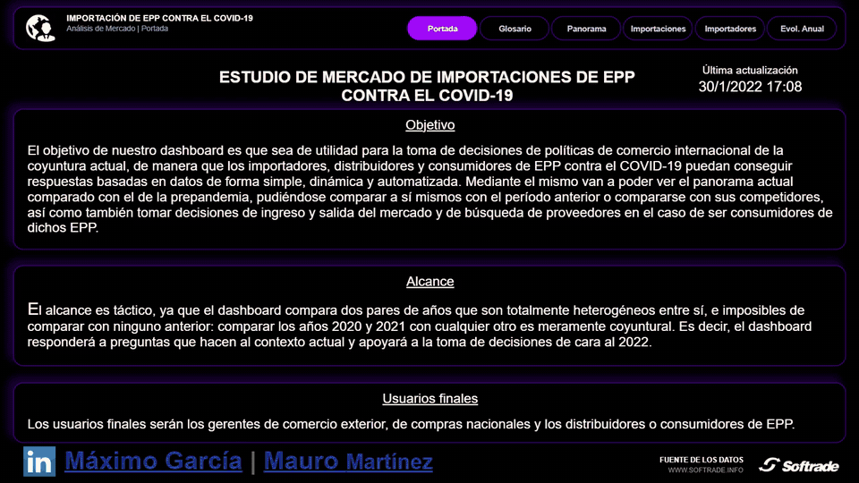
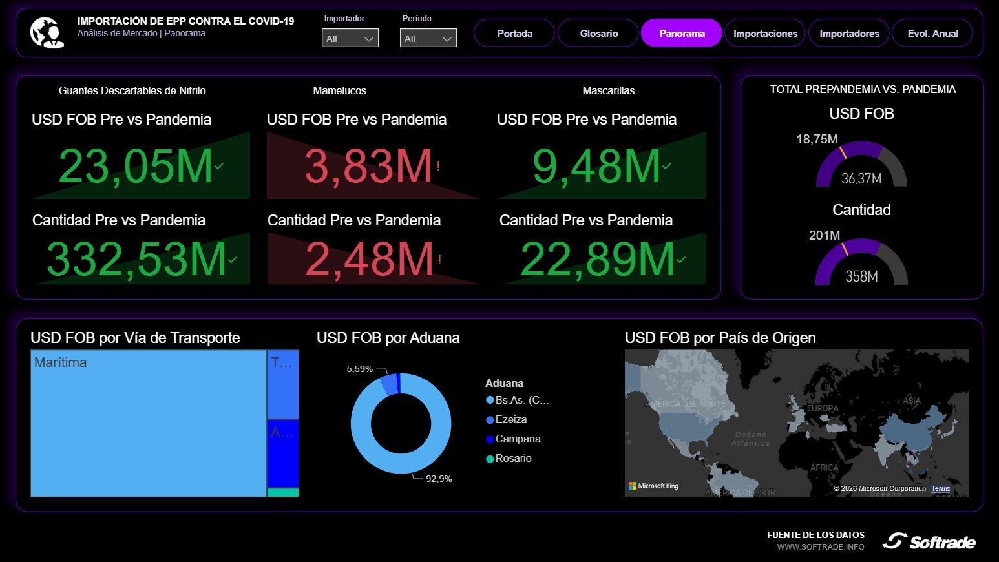
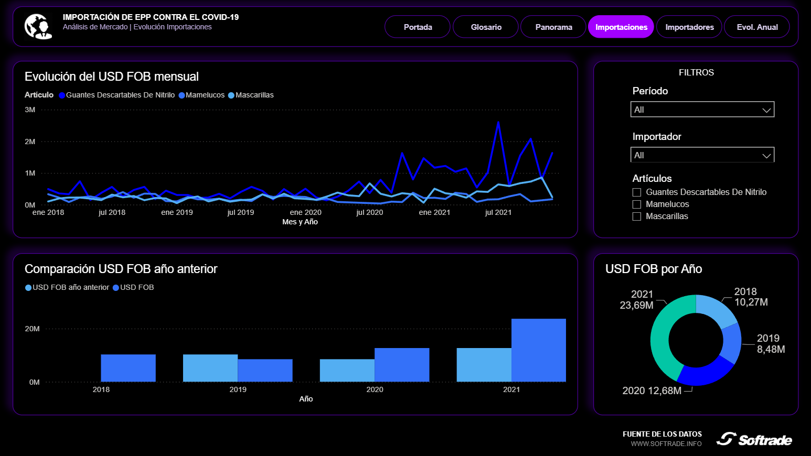
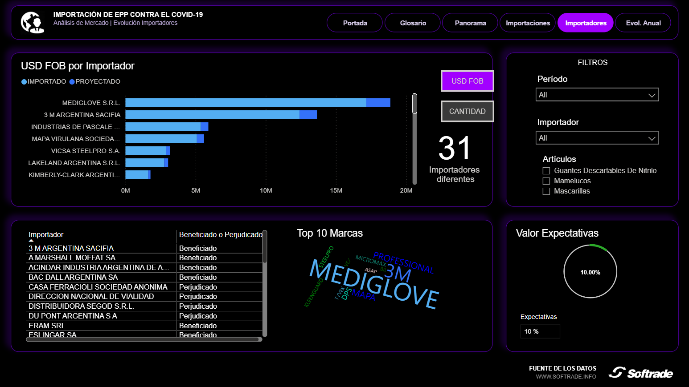
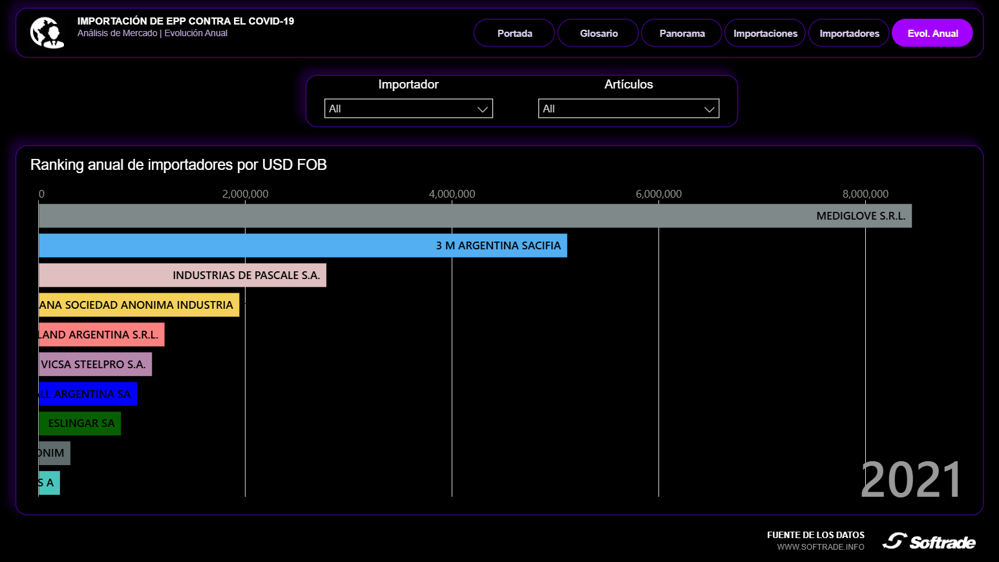
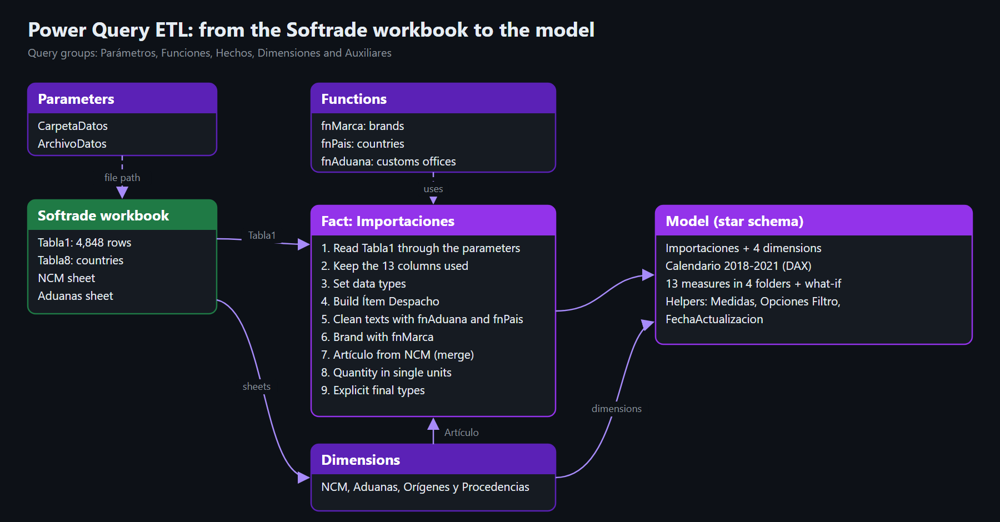
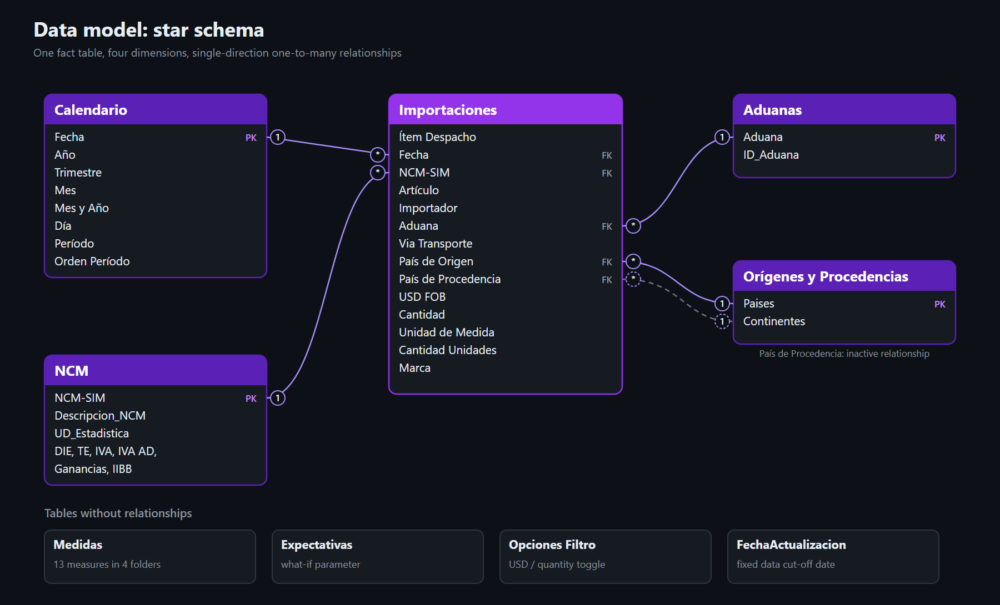
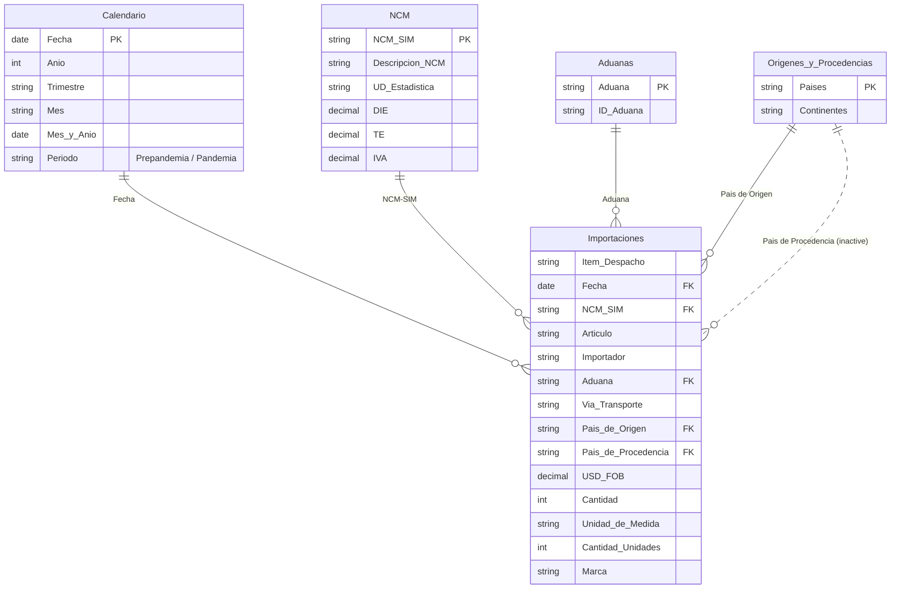

# 🛡️ COVID-19 PPE Import Market Study (Pre-pandemic vs. Pandemic)
<p>
  <a href="README.md"></a>
  <a href="README.es.md"></a>
</p>

## 📽️ Dashboard Preview
<p align="center">
  
</p>

<p align="center"><a href="docs/Preview-v2.mp4">▶️ Watch the walkthrough in full quality (MP4)</a></p>

> Final project of the CoderHouse Data Analyst course, built together with Máximo García. The dashboard is in Spanish.
> The repository includes the report as a **Power BI Project (PBIP)**, so the data model, the DAX measures and the Power Query code can be read right here on GitHub. The data itself is not published (see [About the data](#-about-the-data)).

**Stack:**     

## 📋 Executive Summary
A market study of Personal Protective Equipment (PPE) imports into Argentina for three products: **nitrile disposable gloves, face masks and protective coveralls**. It compares the pre-pandemic period (**2018-2019**) with the COVID-19 period (**2020-2021**), 24 months each.

The data comes from **Softrade** customs import records: 4,848 rows, made of 3,696 valued declaration items plus 1,152 brand and description lines that carry no value or quantity. The report is **static by design**: both periods are fixed, and the data cut-off is 30 January 2022.

It answers questions such as: how much did each product grow, which countries and importers drove that growth, how prices and transport modes changed, and how a given importer compares with its competitors.

## 📈 Key Findings

| Indicator (USD FOB) | 2018-2019 | 2020-2021 | Change |
|---|---:|---:|---:|
| **Total PPE imports** | 18.75 M | 36.37 M | **+94%** |
| Nitrile disposable gloves | 8.77 M | 23.05 M | +163% |
| Face masks | 4.67 M | 9.48 M | +103% |
| Protective coveralls | 5.30 M | 3.83 M | **-28%** |
| Air freight | 0.09 M (0.5% of value) | 2.98 M (8.2% of value) | x32 |

- **Gloves led every single year** and drove most of the growth: 15.37 M in 2021 alone, 65% of that year's imports.
- **Coveralls were the exception:** both value (-28%) and units (-38%) fell during the pandemic.
- **Malaysia supplied 47% of the value**, followed by China (23%) and the United States (14%). Imports from Malaysia grew from 7.04 M to 18.73 M.
- **Prices moved in opposite directions:** the average face mask fell from USD 0.89 to USD 0.41 per unit (-53%), while the average nitrile glove rose from USD 0.046 to USD 0.069 (+52%).
- **23 of the 31 importers bought more** during the pandemic, 8 of them with no purchases in 2018-2019. MEDIGLOVE S.R.L. more than tripled its purchases (4.02 M to 13.14 M) and leads the market.
- **Buenos Aires (Capital) customs** cleared 93% of the value.

These are observed changes between two fixed periods. The data shows what changed, not why it changed.

## 🖥️ Dashboard Pages

<table>
  <tr>
    <td width="50%"><br><b>Panorama</b>: KPI cards and gauges for both periods, transport mode, customs office and country of origin.</td>
    <td width="50%"><br><b>Evolución Importaciones</b>: monthly FOB value by product, year-over-year comparison and share by year.</td>
  </tr>
  <tr>
    <td width="50%"><br><b>Evolución Importadores</b>: importer ranking with a what-if projection (USD or units), importers that gained or lost, and top brands.</td>
    <td width="50%"><br><b>Evolución Anual</b>: animated bar chart race of the importers, year by year.</td>
  </tr>
</table>

The report also has a cover page with the objective, scope and target users, and a glossary of international trade terms. It was designed for international trade and purchasing managers, distributors and buyers of PPE, to compare themselves with competitors and with the previous period, and to support market entry, exit and supplier decisions.

## 🔄 Data Preparation (Power Query)
The Power Query is organized so anyone who opens the project can follow it.

<p align="center">
  
</p>

Queries are grouped in folders:

| Folder | Queries | Purpose |
|---|---|---|
| Parámetros | `CarpetaDatos`, `ArchivoDatos` | Location of the Excel source. Point `CarpetaDatos` to the folder that holds your own workbook. |
| Funciones | `fnMarca`, `fnPais`, `fnAduana` | Reusable cleaning functions, documented: Power Query shows their description and examples when you invoke them. |
| Hechos | `Importaciones` | Fact table, one row per line of a customs declaration. |
| Dimensiones | `NCM`, `Aduanas`, `Orígenes y Procedencias` | Lookup tables, completed with every value that appears in the fact table. |
| Auxiliares | `Medidas`, `Opciones Filtro`, `FechaActualizacion` | Measures container, USD/quantity toggle and the fixed data cut-off date. |

**`Importaciones` step by step**
1. Read `Tabla1` from the Excel file through the parameters.
2. Keep only the 13 source columns the model needs.
3. Set data types.
4. Build `Ítem Despacho` (declaration id plus item number).
5. Normalize texts: importer names with broken encoding, customs offices (`fnAduana`), transport mode (ACUATICA to Marítima, and so on) and countries of origin and shipment (`fnPais`).
6. Build `Marca` from the raw `MARCA: ...` field with `fnMarca`.
7. Take `Artículo` from the NCM dimension (merge on `NCM-SIM`).
8. Add `Cantidad Unidades`: the declared quantity converted to single units (1 pair = 2, 1 dozen = 12, 1 thousand = 1,000).
9. Set explicit final types for every loaded column.

`fnMarca` normalizes brands with two short lists, one for exact typos and one for brand families:

```powerquery
Equivalencias = {{"3 M", "3M"}, {"ASNELL", "ANSELL"}, {"MEDIGLOLVE", "MEDIGLOVE"}, {"S/", "S/M"}, ...},
Familias = {{"CHEMMAX", "CHEMMAX"}, {"SALISBURY", "SALISBURY"}, {"MAPA PROFESS", "MAPA PROFESSIONAL"}, ...},
Resultado =
    if Marca = "" then "S/M"
    else if not List.IsEmpty(Exacta) then Exacta{0}{1}
    else if not List.IsEmpty(Familia) then Familia{0}{1}
    else Marca
```

**Data quality checks**

| Check | Result |
|---|---|
| Total value, source workbook vs. model | USD 55,120,585.66 in both |
| Rows that match every dimension (date, NCM, customs office, country) | 4,848 of 4,848 |
| Valued items with a unique declaration-item key | 3,696 of 3,696 |
| Brands | 66 distinct brands; 1.8% of the value has no declared brand (S/M) |
| Quantity | Pairs, dozens and thousands converted to single units |

## 🏗️ Data Model
Star schema with one fact table and four dimensions. The measures live in their own table, and three disconnected tables support the report interactions: the USD/quantity toggle, the what-if parameter and the data cut-off date.

<p align="center">
  
</p>

<details>
<summary>Same model as a Mermaid diagram</summary>



</details>

### Measures

| Folder | Measures | What they do |
|---|---|---|
| 1. Base | `Total USD FOB`, `Total Unidades`, `Importadores diferentes` | Building blocks for everything else. |
| 2. Períodos | `USD FOB Prepandemia`, `USD FOB Pandemia`, `Unidades Prepandemia`, `Unidades Pandemia`, `Variación USD FOB %`, `Variación Unidades %`, `Beneficiado o Perjudicado` | Fixed-period comparison (2018-2019 vs 2020-2021). |
| 3. Tiempo | `USD FOB año anterior` | Year-over-year comparison with `SAMEPERIODLASTYEAR`. |
| 4. Escenarios | `IMPORTADO`, `PROYECTADO` | USD/units toggle and what-if projection (with `Valor Expectativas`). |

The KPI trend axis uses `Calendario[Período]`, which is sorted by a hidden order column. Power BI also groups by that sort column, so the period measures clear it too:

```dax
USD FOB Prepandemia =
CALCULATE (
    [Total USD FOB],
    Calendario[Período] = "Prepandemia",
    REMOVEFILTERS ( Calendario[Orden Período] )
)
```

Every table, column, measure and Power Query step can be reviewed in [`Importaciones_EPP.SemanticModel/definition`](Importaciones_EPP.SemanticModel/definition) (TMDL format).

## ⚠️ Scope and Limitations
- **Static report:** the periods are fixed and the data ends on 28 December 2021 (cut-off 30 January 2022). Refreshing the same workbook gives the same results.
- **Free-text fields:** brands, countries and customs offices come from declaration text and are normalized with the functions above.
- **Descriptive lines:** 1,152 rows are brand or description lines with no value or quantity. They are kept as delivered by the source and do not change any total.
- **Quantities:** declarations use units, pairs, dozens and thousands. All are converted to single units before any comparison.

## 📂 Repository Structure

```
├── Importaciones_EPP.pbip                       # the dashboard as a Power BI Project (source code)
├── Importaciones_EPP.SemanticModel/definition/  # data model as code (TMDL): tables, measures, Power Query
├── Importaciones_EPP.Report/definition/         # report as code (PBIR): one folder per page and visual
├── Preview-v2.gif                               # dashboard walkthrough (embedded above)
├── docs/Preview-v2.mp4                          # dashboard walkthrough in full quality
├── docs/img/                                    # README images: pages, ETL flow and data model
├── .github/pull_request_template.md             # checklist for every change
├── .gitignore                                   # keeps .pbix files, local caches and the data folder out of the repository
└── LICENSE
```

## ▶️ How to Open It
The repository holds the dashboard as a Power BI Project (`Importaciones_EPP.pbip`): the model (TMDL) and the report (PBIR) as text files. The `.pbix` and the source workbook are not included, because the data is licensed (see [About the data](#-about-the-data)).

**Option 1: read the code.** Browse [`Importaciones_EPP.SemanticModel/definition`](Importaciones_EPP.SemanticModel/definition) for the tables, measures and Power Query, and [`Importaciones_EPP.Report/definition`](Importaciones_EPP.Report/definition) for the pages and visuals.

**Option 2: load it with your own data.**
1. Clone the repository (or download it as a ZIP).
2. Prepare an Excel workbook with a table named `Tabla1` holding the 13 columns the query reads: `Identificador`, `Item`, `Fecha`, `NCM-SIM`, `Importador`, `Aduana`, `Via Transporte`, `País de Origen`, `Pais de Procedencia`, `U$S FOB`, `Cantidad`, `Unidad de Medida` and `Marca - Sufijos`, plus a `Tabla8` table with countries and continents (`Paises`, `Continentes`) and the `NCM` and `Aduanas` sheets used by the dimensions. A customs import export from Softrade has this layout.
3. Open `Importaciones_EPP.pbip` with a recent version of Power BI Desktop.
4. Go to **Home > Transform data > Edit parameters**. Set `CarpetaDatos` to the folder that holds your workbook (ending with `\`) and `ArchivoDatos` to its file name.
5. Click **Refresh**.

## 🔒 About the data
The data comes from Softrade, a paid platform, and is licensed to the account that downloaded it, so it cannot be republished. The raw records and the `.pbix` (which stores them inside) are not published; the screenshots, the video and the figures quoted above show the results of the analysis.

## 👥 Authors
**Mauro Martínez** and **Máximo García**. Data source: [Softrade](https://www.softrade.info).

The project files are released under the [MIT License](LICENSE). The data remains subject to the terms of its source.
